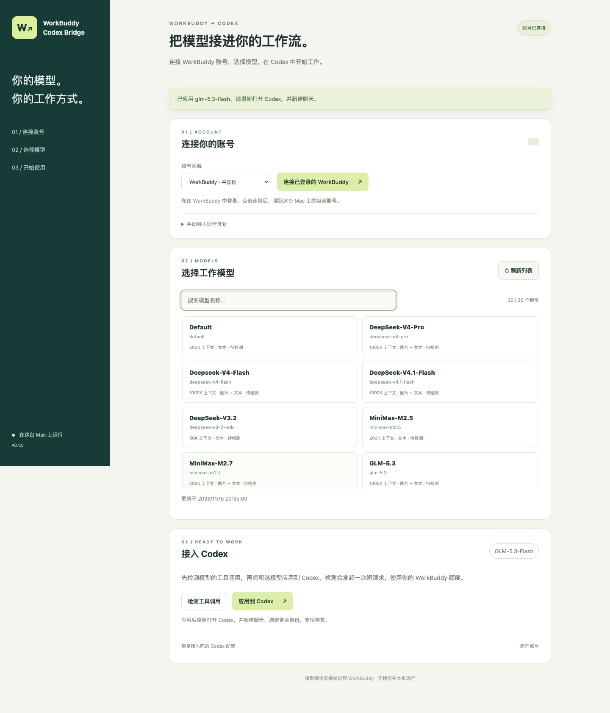

# WorkBuddy Codex Bridge

**在 Mac 上连接自己的 WorkBuddy 账号，选择账号可用的模型，在 Codex 中使用。**

安装包包含独立运行时。你只需要 **WorkBuddy + Codex + 本软件**，不需要安装 DeepSeek Harness、OpenCodex、Node.js 或 Homebrew。

[下载最新版本](https://github.com/y1536103801-ui/workbuddy-codex-bridge/releases/latest) · [完整安装说明](docs/INSTALL.zh-CN.md) · [反馈问题](https://github.com/y1536103801-ui/workbuddy-codex-bridge/issues)

## 1. 下载适合你的安装包

需要 **macOS 13.5 或更高版本**。点击 Mac 左上角 ** → 关于本机**，查看“芯片”或“处理器”。

| 你的 Mac | v0.1.0 安装包 | 验收情况 |
| --- | --- | --- |
| Apple 芯片（M 系列） | [下载 Apple 芯片版 · arm64 · 约 38 MB](https://github.com/y1536103801-ui/workbuddy-codex-bridge/releases/download/v0.1.0/WorkBuddy-Codex-Bridge-0.1.0-macOS-arm64.zip) | 已完成真实安装、账号连接和 Codex 读写文件任务 |
| Intel 处理器 | [下载 Intel 版 · x64 · 约 39 MB](https://github.com/y1536103801-ui/workbuddy-codex-bridge/releases/download/v0.1.0/WorkBuddy-Codex-Bridge-0.1.0-macOS-x64.zip) | 已构建并校验，尚未在 Intel 实机运行 |

下载这里的安装 ZIP。Release 底部的 **Source code (zip / tar.gz)** 是给开发者的源码，不是安装包。Intel 用户还需要自行安装支持 Intel 的 Codex 客户端；连接器的 Intel 包不包含 Codex。

开始前，准备好：

- 已安装并登录的 WorkBuddy：中国区从 [WorkBuddy 官网](https://www.codebuddy.cn/work/) 获取；国际区使用 [WorkBuddy AI](https://www.workbuddy.ai/)。
- 已安装、能正常打开的 Codex：[OpenAI 桌面客户端下载入口](https://chatgpt.com/download/)，或已安装的 Codex CLI。桌面入口以官方页面提供的版本为准。

## 2. 安装并打开设置页面

1. 双击下载的 ZIP 解压。
2. 打开解压后的文件夹，双击 **安装.command**。系统会打开终端并执行安装；也可以直接打开文件夹内的 **WorkBuddy Codex Bridge.app**。
3. 安装完成后，浏览器会自动打开这台 Mac 上的设置页面。
4. 应用安装在 `~/Applications/WorkBuddy Codex Bridge.app`。以后可从 Finder 的个人“应用程序”目录或 Spotlight 搜索并打开它。

**首次打开被 macOS 拦截时：** v0.1.0 使用本地临时签名，尚无 Apple Developer ID 公证。在 Finder 中右键该应用或安装脚本，选择“打开”；如果仍被拦截，在“系统设置 → 隐私与安全性”找到对应拦截记录并选择“仍要打开”，再重新打开应用。无需关闭 Gatekeeper。

安装器会为当前用户设置登录启动项。关闭设置网页后，连接器仍在后台运行。首次安装若默认端口被占用，会自动选择空闲端口。

## 3. 连接 WorkBuddy 账号

### 推荐：连接当前已登录账号

1. 在 **WorkBuddy 桌面应用**里登录自己的账号。
2. 回到连接器设置页，在“账号区域”中选择 **WorkBuddy · 中国区**；如果你登录的是国际版，选择 **WorkBuddy AI · 国际区**。
3. 点击 **连接已登录的 WorkBuddy**。
4. 等待页面显示 **账号已连接**，并出现模型列表。

点击连接后，软件才会读取本机当前 WorkBuddy 登录。无需把账号密码填写到连接器。

### 可选：手动导入凭证

已有完整账号凭证时，展开 **手动导入账号凭证**，粘贴 JSON，然后点击 **导入并连接**。

支持包含 `auth` / `account` 的完整登录 JSON，也支持平铺字段：`accessToken`、`refreshToken`、`uid`、`expiresAt`；企业账号还需相应的 `enterpriseId`，国际区需正确的 `domain`。`expiresAt` 是实际到期时间的 Unix 时间戳（秒或毫秒）。只填写一个过期的 access token 无法完成连接。

凭证存放在你的 Mac 私有数据目录，导入后输入框清空。不要将真实凭证贴到 GitHub Issue。

## 4. 选择模型并应用到 Codex

1. 在 **选择工作模型** 中点击一个模型卡片；可用搜索框查找，也可点击 **刷新列表** 更新当前账号目录。
2. 点击 **检测工具调用**。这会向所选模型发送一次短请求，使用你的 WorkBuddy 账号额度；成功后卡片显示“工具检测通过”。
3. 点击 **应用到 Codex**。看到“已应用 …”提示后，完全退出并重新打开 Codex。
4. 在 Codex 中**新建聊天**，开始使用所选模型。若使用 CLI，重新启动 `codex`。

模型列表来自当前账号，不固定为 DeepSeek，也不固定为某几个模型。列表中的模型可选择；“待检测”表示尚未完成工具验证，不等于不可用。模型实际访问权限、额度和限流由 WorkBuddy 账号决定。

**以后切换模型：** 打开连接器 → 点击新模型 → 点击“应用到 Codex” → 重开 Codex 并新建聊天。单击卡片只改变连接器中的选择，点击“应用到 Codex”才会更新 Codex 配置。

<details>
<summary>查看设置页面</summary>



</details>

## 5. 确认已经可以使用

先在连接器运行“检测工具调用”。然后在 Codex 中打开一个专门的测试文件夹，新建聊天并输入：

> 在当前文件夹创建 hello.txt，内容为 Hello from WorkBuddy，然后读取这个文件并告诉我读到了什么。

确认文件确实创建、内容正确，并且 Codex 完成回复。若只是模型列表出现、任务没有完成，请根据下面的提示排查。

## 常见问题

| 现象 | 处理方式 |
| --- | --- |
| 设置页提示“请从应用重新打开设置页面” | 从 WorkBuddy Codex Bridge.app 重新打开；不要只复制本地网页地址到另一浏览器。 |
| 没有找到已登录账号 | 打开对应区域的 WorkBuddy，重新登录，再点击连接。 |
| 模型列表为空或找不到某个模型 | 清空搜索条件并刷新列表；确认账号区域。列表以当前账号上游返回结果为准。 |
| 模型切换后 Codex 仍显示旧模型 | 确认点过“应用到 Codex”，完全退出并重开 Codex，再新建聊天。 |
| 检测工具调用失败 | 查看页面提示，换一个模型检测；出现在目录中不代表该模型已经通过 Codex 工具验证。 |
| 提示额度不足、HTTP 429 或模型限流 | 根据 WorkBuddy 返回的原因处理，或选择其他可用模型后重新应用。软件不会自动重复提交生成。 |
| 提示当前账号有请求正在进行 | 等当前请求结束后继续；首版每个账号同时处理一个生成请求。 |
| 提示 Codex 配置被其他程序修改 | 按提示检查被改动字段；恢复操作会停止，避免覆盖后来的设置。 |
| 应用没有打开设置页面 | 查看数据目录中的 `service-error.log`，在 Issue 提交经过脱敏的错误文字。 |

## 恢复、升级和卸载

- **恢复原模型设置：** 在设置页点击“恢复接入前的 Codex 配置”，然后重开 Codex。
- **断开账号：** 在设置页点击“断开账号”，清除本软件保存的账号凭证。断开前可先恢复 Codex，避免它继续请求一个已断开的账号。
- **升级：** 等正在运行的任务结束，下载新版本并运行其“安装.command”。
- **卸载：** 运行解压目录中的“卸载.command”。它会先恢复本软件管理的 Codex 设置，再删除应用和登录启动项；数据目录保留以便恢复。需要清除凭证时，先在设置页断开账号。

## 数据与配置

- 应用数据：`~/Library/Application Support/WorkBuddy Codex Bridge/`，目录权限为 `0700`，凭证文件为 `0600`。
- 本地服务只监听 `127.0.0.1`。默认端口为 `13246`；实际端口记录在数据目录的 `service.json` 中。
- “应用到 Codex”会更新 `~/.codex/config.toml`（或所配置的 `CODEX_HOME`）。原始配置文本备份为数据目录中的 `codex-config.original.toml`。
- 更新保留其他配置值，但重写 TOML 会移除注释。恢复操作只还原本软件管理的设置，并检测后续修改。
- 模型请求直接发送到 WorkBuddy 服务，使用用户自己的账号额度；本项目不运营中转服务器。凭证缓存依赖 macOS 文件权限，首版尚未接入 Keychain。

[本地接口与凭证边界](docs/SECURITY.md)

## 当前版本的验收范围

v0.1.0 已通过 14 项自动测试，Apple 芯片正式安装包完成安装、连接中国区账号、Codex CLI 工具读写文件、恢复配置和卸载。Codex `app-server model/list` 实际返回 30 个模型；这个数量来自验收账号，不保证其他账号相同。

真实编程任务验证了 **GLM-5.3-Flash**；其他模型可在设置页单独检测。Intel 包尚无 Intel 实机验收，国际区入口尚无国际区账号真实验收。桌面后端模型列表已验证；桌面界面完整交互未作单独验收。

连接器转换 Responses API 与 WorkBuddy Chat Completions，支持流式文本、推理历史、函数/自定义工具、工具结果续接、图片输入能力检查与取消。首版不提供 OpenAI 托管 Web Search，应用配置时会关闭 Codex 的内置 Web Search；也不保存 `previous_response_id` 远端会话，由客户端发送完整历史实现续接。

[验收记录](docs/STATUS.md) · [安装包验收摘要](evidence/package-check.json)

## 开发与构建

开发需要 macOS、Node >=22.19。发行包内置 Node 24.22.2。

```sh
git clone https://github.com/y1536103801-ui/workbuddy-codex-bridge.git
cd workbuddy-codex-bridge
npm ci
npm run check
npm run package
```

打包会从 nodejs.org 下载固定版本的 arm64 / x64 运行时，核对官方 SHA256，再生成 `.app` 和 ZIP；构建需要 Xcode Command Line Tools 中的 Swift 编译器和 macOS 工具。依赖锁定在 `package-lock.json`。

主要目录：`src/` 独立连接器；`vendor/` 保留许可的复用源码；`web/` 设置页面；`scripts/` 构建与验收；`test/` 自动测试；`evidence/` 脱敏验收摘要。

## 许可证与来源

[MIT License](LICENSE)。复用模块保留原版权声明，见 [代码来源](docs/PROVENANCE.md)、`vendor/workbuddy/LICENSE` 和 `THIRD_PARTY_NOTICES.txt`。发行包包含 Node 与 smol-toml 的许可证。本项目为独立社区项目。
